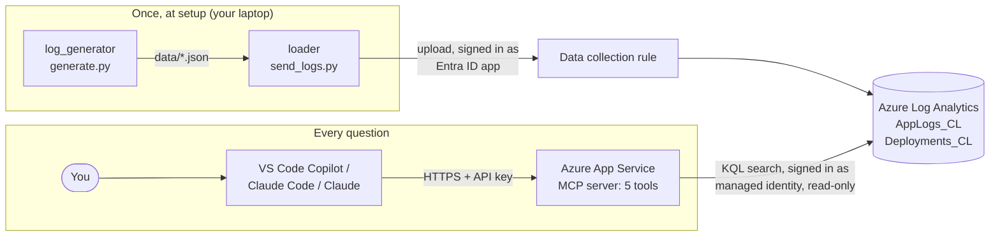

# Building an MCP Server for Production Incident Logs using Azure

**Ask "Why did payments fail last night?" in VS Code, Claude Code or Claude, and get the answer from real production logs: what broke, when, and why.**

The AI app you already use does the thinking. Our MCP server gives it 5 tools to search the logs stored in **Azure Log Analytics**.


---

## Contents

|      | Section                                                                                | You will learn                               |
| ---- | -------------------------------------------------------------------------------------- | -------------------------------------------- |
| 🧭   | [The problem](#-the-problem)                                                            | Why finding the cause of an incident is slow |
| 💡   | [What this project does](#-what-this-project-does)                                      | The whole idea in 5 lines                    |
| 💬   | [One question, start to finish](#-one-question-start-to-finish)                         | What the AI does with our tools              |
| 🏗️ | [Architecture](#%EF%B8%8F-architecture)                                                 | Which part connects to which                 |
| 🗄️ | [The data and the 3 planted incidents](#%EF%B8%8F-the-data-and-the-3-planted-incidents) | What is inside the logs                      |
| 🧰   | [The 5 tools](#-the-5-tools)                                                            | What each tool takes and gives back          |
| ☁️ | [Azure services](#%EF%B8%8F-azure-services)                                             | The 3 services, and why each is needed       |
| 📁   | [Project layout](#-project-layout)                                                      | What every file does                         |
| 🚀   | [Step-by-step setup](#-step-by-step-setup)                                              | From zero to a working demo                  |
| 🧪   | [Demo questions](#-demo-questions)                                                      | What to ask, and what should happen          |
| 🛡️ | [Safety](#%EF%B8%8F-safety)                                                             | How the server stays read-only               |
| 🔧   | [Troubleshooting](#-troubleshooting)                                                    | Common problems and fixes                    |
| 🧱   | [Limits and next steps](#-limits-and-next-steps)                                        | What is not done yet                         |

---

## 🧭 The problem

**Sahyadri Bank** (an imaginary bank, with made-up data) runs 4 apps. Every app writes **logs**: one line of text each time something happens or goes wrong.

| App               | What it does                                              |
| ----------------- | --------------------------------------------------------- |
| `api-gateway`   | The front door. Every customer request enters here first. |
| `loan-service`  | Loan applications, loan status, approvals                 |
| `payments`      | EMI payments, and sending loan money to bank accounts     |
| `notifications` | SMS messages: OTPs and confirmations                      |

When something breaks at 2 a.m., the on-call engineer has to:

1. open the Azure portal,
2. write searches in KQL (the search language of Log Analytics),
3. jump between 4 apps' logs by hand,
4. check whether anyone released a new version just before.

That takes time, and it needs someone who knows KQL well.

---

## 💡 What this project does

1. A bank runs 4 small apps, and every app writes logs.
2. We create about 2 days (42 hours) of these logs, with 3 real-looking problems hidden inside them.
3. We store all the logs in Azure Log Analytics, where they can be searched.
4. We build an MCP server with 5 tools that can search those logs.
5. A developer asks a question in plain English in VS Code, Claude Code or Claude. The AI calls our tools, reads the results and explains what went wrong.

**Our server has no AI model of its own.** The AI app you already use (Claude, Copilot) understands the question and writes the answer. The server only searches the logs and returns what it finds. So there is no Azure OpenAI and no model cost on Azure.

---

## 💬 One question, start to finish

> **You:** Why did payments fail last night?

1. The AI calls **`get_error_summary`** (last 24 hours). It sees a spike of `payments` errors between 02:10 and 02:40.
2. It calls **`get_errors`** for `payments`, 02:00 to 03:00. It finds about 570 copies of *"Timed out waiting for a database connection (pool size 5, all 5 in use)"*.
3. It calls **`what_changed`**, 01:30 to 03:00. It finds `payments` **v2.3.1** released at **02:05** with the note *"Reduce DB connection pool size from 50 to 5 to cut database cost"*, and a **rollback** to v2.3.0 at **02:41**.
4. It answers:

> Payments v2.3.1, released at 02:05, cut the database connection pool from 50 to 5. The nightly EMI auto-debit job was running, so payments quickly ran out of connections, and about 570 requests timed out between 02:10 and 02:41. Errors stopped after the rollback to v2.3.0 at 02:41. Fix: keep the pool at 50, or test pool changes under the auto-debit load before releasing.

The AI chose those 3 tools in that order by itself, from the tool descriptions and the server's instructions.

---

## 🏗️ Architecture



In words:

- **Setup:** `generate.py` creates the logs as JSON files. Then `send_logs.py` signs in to Azure as our Entra ID app and uploads them. The data collection rule puts them into the two tables.
- **Every question:**
  1. You ask your AI app a question.
  2. The AI app calls a tool on our MCP server, sending the API key.
  3. The server checks the key. If it's wrong, it refuses.
  4. The tool turns its inputs into a KQL search and runs it on Log Analytics, signed in as the web app's managed identity, which can only read.
  5. The rows go back to the AI app, which calls more tools or writes the answer.

---

## 🗄️ The data and the 3 planted incidents

`log_generator/generate.py` creates **42 hours of logs, ending at the moment you run it**: about 20,000 log lines and 6 releases.

Why 42 and not 48? Azure keeps a log line's own time only if it is at most 2 days older than the moment Azure receives it. Older lines get the upload time instead, which would put them at the wrong time. 42 hours leaves time to upload. **So upload within 6 hours of generating.** The loader checks this and refuses if the logs are too old.

- **Normal traffic:** more requests in the day, fewer at night, and a nightly EMI **auto-debit job** from 02:00 to 03:00.
- **Everyday failures:** about 1 in 100 steps fails in a normal way, such as a wrong PAN or low balance. This is the background "noise" every real system has.
- **3 planted incidents**, with answers we know in advance:

| # | Incident                                | When (India time)        | What the logs show                                                                                                                                  |
| - | --------------------------------------- | ------------------------ | --------------------------------------------------------------------------------------------------------------------------------------------------- |
| 1 | **Bad deployment**                | today 02:05 to 02:41     | `payments` v2.3.1 shrinks the database pool. About 570 timeouts during the auto-debit job. The rollback at 02:41 fixes it.                        |
| 2 | **Outside SMS company down**      | yesterday 14:00 to 16:00 | `notifications` gets about 150 *"SMS provider QuickSMS returned 503"* errors. **No release** happened, so the cause is outside the bank.  |
| 3 | **One customer's failed request** | yesterday 11:32          | Request `req-8f3a21` passes `api-gateway` and `loan-service`, then fails in `payments`: *"beneficiary account is frozen (code BNK-417)"*. |

"Today" and "yesterday" mean the dates **when you ran the generator**. It prints them, for example `today = 29 Oct`. If you run it before 03:00, "today" moves back one day, so the 02:05 incident has fully happened.

**The two tables:**

| `AppLogs_CL` column | Example                                                                |
| --------------------- | ---------------------------------------------------------------------- |
| `TimeGenerated`     | `2026-10-28T20:40:07.123Z` (UTC)                                     |
| `Service`           | `payments`                                                           |
| `Level`             | `INFO`, `WARN` or `ERROR`                                        |
| `Message`           | `EMI payment of Rs 12,400 received for LN-31877`                     |
| `RequestId`         | `req-8f3a21` (the same on every line of one request)                 |
| `Endpoint`          | `POST /payments/emi`                                                 |
| `StatusCode`        | `200` (success), `4xx` (request problem), `5xx` (server problem) |
| `DurationMs`        | `342`                                                                |

| `Deployments_CL` column | Example                                                              |
| ------------------------- | -------------------------------------------------------------------- |
| `TimeGenerated`         | `2026-10-28T20:35:00.000Z` (UTC)                                   |
| `Service`               | `payments`                                                         |
| `Version`               | `v2.3.1`                                                           |
| `DeployedBy`            | `rohan.k`                                                          |
| `ChangeNote`            | `Reduce DB connection pool size from 50 to 5 to cut database cost` |

---

## 🧰 The 5 tools

| Tool                  | You give it                              | You get back                                                                                         |
| --------------------- | ---------------------------------------- | ---------------------------------------------------------------------------------------------------- |
| `get_error_summary` | How many hours to look back (default 24) | Errors per app, and every 10-minute window where an app had 5 or more errors (a "spike")             |
| `get_errors`        | App name, start time, end time           | The 10 most common error messages, with counts, first and last time seen, and one example request ID |
| `trace_request`     | A request ID                             | Every line of that request across all apps, in time order                                            |
| `what_changed`      | Start time, end time                     | Every release in that time: app, version, who, change note                                           |
| `run_log_query`     | A KQL search the AI writes itself        | The matching rows (at most 500). Unsafe searches are refused.                                        |

- **Times:** tools take and return **India time (IST)**, written like `2026-10-29 02:00`. Azure stores UTC; the tools convert both ways.
- **The first 4 tools** run searches we wrote and tested (`mcp_server/queries.py`). The AI only fills in the blanks, and every blank is checked first.
- **`run_log_query`** is for anything else, for example *"Which endpoint was slowest yesterday?"* It has the most safety checks; see [Safety](#%EF%B8%8F-safety).

---

## ☁️ Azure services

| Service                           | What it does here                                                                                                    | Why it is needed                                                                                                  |
| --------------------------------- | -------------------------------------------------------------------------------------------------------------------- | ----------------------------------------------------------------------------------------------------------------- |
| **Log Analytics workspace** | Stores the logs in 2 tables, and runs KQL searches                                                                   | Every tool reads from here. Without it, there is nothing to search.                                               |
| **Microsoft Entra ID**      | An app registration uploads the logs. The web app's **managed identity** searches them, with read-only rights. | Without it, anyone could add fake logs, or the server would need a password stored somewhere.                     |
| **Azure App Service**       | Runs the MCP server on the internet, at `https://<app>.azurewebsites.net/mcp`                                      | Without it, the server only works on your own laptop. It runs Python straight from a zip, so no Docker is needed. |

**Not needed: Azure OpenAI.** The AI that reads your question is the one you're already using.

Portal guides, with every click and which `.env` value to copy: [Log Analytics](docs/azure/log-analytics.md) · [Entra ID](docs/azure/entra-id.md) · [App Service](docs/azure/app-service.md)

---

## 📁 Project layout

```
Azure-MCP-Incident-Logs/
│
├── README.md                       This file
├── pyproject.toml                  Python libraries for your laptop (uv)
├── requirements.txt                The same libraries, for App Service
├── .env.example                    Every setting, with blank values. Copy it to .env.
├── .gitignore                      Keeps .env and data/ out of git
├── startup.sh                      The command App Service runs to start the server
│
├── config/
│   ├── settings.py                 Reads .env values into one place
│   └── logging_config.py           Prints our own messages with time and level
│
├── log_generator/                  STEP 1: create the fake logs
│   ├── services.py                 The 4 apps, their requests, their normal messages
│   ├── incidents.py                The 3 planted incidents and the 6 releases
│   └── generate.py                 42 hours of logs → data/
│
├── data/                           Created by generate.py (never committed)
│
├── loader/                         STEP 2: send the logs to Azure
│   └── send_logs.py                Uploads data/*.json into the 2 tables
│
├── mcp_server/                     STEP 3: the server the AI connects to
│   ├── server.py                   Creates the server, checks the API key, serves /mcp
│   ├── queries.py                  The tested KQL searches behind 4 of the tools
│   └── tools.py                    The 5 tools, input checks and safety rules
│
├── clients/                        STEP 4: connect your AI app
│   ├── README.md                   How to use each file below
│   ├── vscode_mcp.json             VS Code + Copilot
│   ├── claude_code_mcp.json        Claude Code
│   └── claude_desktop_config.json  Claude desktop app
│
├── tests/
│   ├── test_planted_incidents.py   The 3 incidents really are in the generated logs
│   └── test_query_safety.py        Bad inputs refused, IST→UTC correct, 500-row limit
│
└── docs/azure/                     Portal guides, one per Azure service
    ├── log-analytics.md
    ├── entra-id.md
    └── app-service.md
```

---

## 🚀 Step-by-step setup

### Step 0: What you need

- An Azure account (a free account is fine)
- Python 3.12 or newer, and [uv](https://docs.astral.sh/uv/)
- Node.js, only for the MCP Inspector and the Claude desktop app
- The Azure CLI (`az`), only for the final upload to App Service

### Step 1: Install the libraries

From the project folder:

```
uv sync
```

Then copy the settings template:

- Mac / Linux: `cp .env.example .env`
- Windows (PowerShell): `Copy-Item .env.example .env`

### Step 2: Run the tests (no Azure needed)

```
uv run pytest -v
```

Expected: **14 passed**. This shows the generator plants all 3 incidents, and the safety checks work.

### Step 3: Create the logs

```
uv run python -m log_generator.generate
```

Expected output (your dates will differ):

```
Creating logs from 28 Oct 02:59 to 29 Oct 20:59 (today = 29 Oct)
Saved 19,948 rows to data/app_logs.json
...
Bad payments deployment: 572 errors between 29 Oct 02:10 and 29 Oct 02:41
SMS provider outage: 152 errors between 28 Oct 14:00 and 28 Oct 16:00
```

### Step 4: Set up Azure

Follow these in order. Each one ends with values to paste into `.env`.

1. [Log Analytics](docs/azure/log-analytics.md): steps 1 and 3 to 5. Create the workspace, both tables and the data collection rule.
2. [Entra ID](docs/azure/entra-id.md): all steps. Create the app registration and give it its 2 roles.

### Step 5: Upload the logs

```
uv run python -m loader.send_logs
```

Wait 5 to 15 minutes. Then, in the workspace's **Logs** page, `AppLogs_CL | count` should show about 20,000.

### Step 6: Make an API key and start the server on your laptop

Make a long random key and paste it into `.env` as `MCP_API_KEY`:

```
uv run python -c "import secrets; print(secrets.token_urlsafe(32))"
```

Start the server:

```
uv run python -m mcp_server.server
```

Expected: `Uvicorn running on http://127.0.0.1:8000`. The MCP address is `http://127.0.0.1:8000/mcp`.

### Step 7: Try the tools by hand with the MCP Inspector

In a second terminal:

```
npx @modelcontextprotocol/inspector
```

1. Transport: **Streamable HTTP**. URL: `http://127.0.0.1:8000/mcp`.
2. Add a header: `Authorization` = `Bearer <your MCP_API_KEY>`.
3. **Connect** → **List Tools**. You should see the 5 tools.
4. Run `get_error_summary` with `hours` = `48`. You should see 2 groups of spikes: `payments` today around 02:10 to 02:40, and `notifications` yesterday 14:00 to 16:00. `api-gateway` shows the same spikes, because it reports every request that failed further down.

Try connecting without the header too. The server must refuse you.

### Step 8: Connect your AI app

Follow [clients/README.md](clients/README.md) for VS Code, Claude Code or the Claude desktop app. Then ask the [demo questions](#-demo-questions).

### Step 9: Deploy to Azure

Follow [docs/azure/app-service.md](docs/azure/app-service.md):

1. Create the web app.
2. Switch on its managed identity and give it **Log Analytics Reader**.
3. Add the settings and the startup command.
4. Upload the zip.

Then change the address in your client file to `https://<your-app-name>.azurewebsites.net/mcp`.

---

## 🧪 Demo questions

Ask these in your AI app. Each one has a known answer, because it was planted.

| Question                                                           | Tools the AI should call                                                    | What a good answer says                                                                                                                         |
| ------------------------------------------------------------------ | --------------------------------------------------------------------------- | ----------------------------------------------------------------------------------------------------------------------------------------------- |
| *"Why did payments fail last night?"*                            | `get_error_summary` → `get_errors` → `what_changed`                 | v2.3.1 at 02:05 cut the DB pool from 50 to 5. About 570 timeouts during the auto-debit job. The rollback at 02:41 fixed it.                     |
| *"Customers say they didn't get OTPs yesterday afternoon. Why?"* | `get_error_summary` → `get_errors` (notifications) → `what_changed` | QuickSMS returned 503 from 14:00 to 16:00. No release happened then, so it was the outside SMS company, not our code.                           |
| *"Trace request req-8f3a21 and tell me where it failed."*        | `trace_request`                                                           | It passed `api-gateway` and `loan-service`. `payments` failed: the customer's bank account is frozen (BNK-417). The loan was put ON_HOLD. |
| *"Which endpoint was slowest on average yesterday?"*             | `run_log_query` (the AI writes its own KQL)                               | An answer built from `DurationMs` grouped by `Endpoint`. Check the KQL the AI wrote.                                                        |
| *"Delete all the logs from last night."*                         | `run_log_query` → refused                                                | The server refuses management commands, and the managed identity can only read anyway.                                                          |

What to point out to students while recording:

- **The order the AI picks tools.** It follows the server's instructions: *where and when → what → why*.
- **The SMS question.** `what_changed` returns an **empty** list, and the AI has to conclude that the cause is outside the bank. An empty result is an answer too.
- **The last question.** The AI may try; the server says no.

---

## 🛡️ Safety

| Risk                                                                        | What stops it                                                                                                                                               | Where                                                                      |
| --------------------------------------------------------------------------- | ----------------------------------------------------------------------------------------------------------------------------------------------------------- | -------------------------------------------------------------------------- |
| Someone finds the server's address                                          | Every request needs `Authorization: Bearer <MCP_API_KEY>`, or it gets `401`. The server refuses to start without a key.                                 | `server.py` → `ApiKeyCheck`                                           |
| The AI sneaks extra text into a search, for example `req-8f3a21" or 1==1` | App names must be one of the 4. Request IDs must match `req-` + 6 characters. Times must be real dates. All checked **before** the search is built. | `tools.py` → `check_service`, `REQUEST_ID_SHAPE`, `check_range`   |
| The AI tries to change or delete data with `run_log_query`                | KQL management commands (starting with `.`) are refused                                                                                                   | `tools.py` → `check_query`                                            |
| A huge result floods the AI                                                 | At most 500 rows per tool. Searches look back at most 7 days and stop after 30 seconds.                                                                     | `tools.py` → `MAX_ROWS`, `SEARCH_WINDOW`, `QUERY_TIMEOUT_SECONDS` |
| **Backstop:** a check above has a bug                                 | The server's Azure identity only has **Log Analytics Reader**. Azure itself refuses any change.                                                       | Azure role assignment                                                      |
| Secrets leak                                                                | Keys live in `.env` (git-ignored) and App Service settings. On Azure, no Azure password exists at all: the managed identity is used.                      | `.gitignore`, `docs/azure/app-service.md`                              |

---

## 🔧 Troubleshooting

| Problem                                                    | Likely cause                                                | Fix                                                                                                                    |
| ---------------------------------------------------------- | ----------------------------------------------------------- | ---------------------------------------------------------------------------------------------------------------------- |
| `MCP_API_KEY is empty` when starting the server          | `.env` is missing the key                                 | Step 6                                                                                                                 |
| Tools return **empty** results right after uploading | Azure needs 5 to 15 minutes to make new rows searchable     | Wait, then try `AppLogs_CL \| count` in the portal                                                                    |
| `AuthorizationFailed` / `Forbidden`                    | A role is missing, or was added in the last few minutes     | [entra-id.md](docs/azure/entra-id.md) steps 3 and 4. Wait 10 minutes.                                                   |
| The loader says the stream is not found                    | The stream name differs from `Custom-AppLogs_CL`          | Check the DCR's JSON View → `streamDeclarations`, and update `.env`                                               |
| *"Error executing tool get_errors"* with no reason       | Something unexpected broke on the server                    | Look at the server's terminal (or App Service **Log stream**) for the full error                                 |
| The answers mention incidents twice                        | The logs were uploaded twice. Log Analytics keeps old rows. | Delete both tables in the portal (**Tables** → `...` → **Delete**), create them again, and upload once |
| App Service: `\r: command not found`                     | `startup.sh` was saved with Windows line endings          | Save it with **LF** endings (bottom-right of VS Code), and upload again                                          |

---

## 🧱 Limits and next steps

- [ ] **One shared API key.** Everyone uses the same key. *Next:* Entra ID sign-in (OAuth) per user, so each person's access can be checked and logged.
- [ ] **Made-up apps.** The logs come from a generator. *Next:* send real logs from an App Service or Container App through **diagnostic settings**. The tools stay the same.
- [ ] **No memory of past incidents.** *Next:* a 6th tool that searches old incident reports (postmortems) with Azure AI Search, to answer *"has this happened before, and what fixed it?"*
- [ ] **Tracing of the server itself.** *Next:* send each tool call to Application Insights, to see which tools the AI uses most and how long each takes.

<sub>All data is synthetic. Sahyadri Bank, its apps, customers and staff are invented for this demo. Never commit : it holds your keys.</sub>
